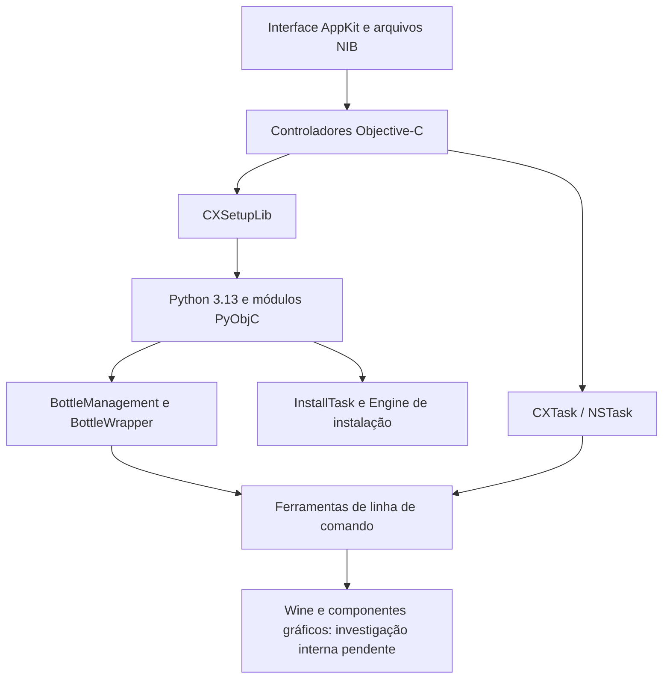

# Engenharia reversa do CrossOver 26.3

Esta investigação usa o executável distribuído, decompilação Hopper por REA, metadados de bytecode Python e arquivos compilados de Interface Builder. O objetivo do Cruzador é uma implementação própria que não dependa da instalação do CrossOver. O protótipo atual ainda depende de um motor externo; esta investigação não estabelece reconstrução integral nem independência.

## Identidade e cobertura

Alvo: `/Applications/CrossOver.app/Contents/MacOS/CrossOver`, SHA-256 `1d245f2f9f52bd56a120616fede8b1eb9cca9fa228319de04a2cbeabd8de7174`. A análise nativa selecionou arm64 do Mach-O universal; o inventário da outra arquitetura não foi decompilado.

O Hopper reportou 10.627 procedimentos e 5.524 objetos de string. O inventário inclui 2.108 métodos Objective-C, 132 nomes de blocos reconhecidos pelo padrão do compilador e 2.037 despachos `_objc_msgSend$…`; os demais nomes incluem auxiliares e funções sem nome recuperado. Essas categorias são uma classificação derivada dos nomes, não uma classificação semântica de cada função. A descoberta completa de funções permanece desconhecida. Evidências: `ev_408ea556820bb1ec8438240492220bef10b61a87c4dfb73567da3fdf13182232` e `ev_5b0612884f4c957cc430ecc1de0710af4f7e640ea251e89a4f313186d752ecb4`.

A primeira etapa exportou 644 registros de pseudocódigo em nove grupos:

| Grupo | Registros |
| --- | ---: |
| NewBottleController | 49 |
| RunCommandController | 59 |
| BottleViewController | 143 |
| CXTask | 9 |
| CXSetupLib | 18 |
| PackageInstaller | 96 |
| MainWindowController | 105 |
| CXServerCrossOver | 87 |
| InstallConfiguration | 78 |

Os totais incluem propriedades, acessores e blocos. Não significam 644 funcionalidades distintas. Os exports terminaram sem falhas nas seleções, mas o Hopper não expõe os intervalos completos dos corpos pelo adaptador. O campo `body.available: false` registra essa limitação; o pseudocódigo foi exportado. Pseudocódigo é uma interpretação do provedor, contém variáveis de registrador e argumentos incompletos, e não deve ser compilado como código-fonte recuperado.

[Catálogo e hashes](../evidence/native-export-catalog.json), [pseudocódigo por grupo](../evidence/decompilation/) e [bundle REA completo](../evidence/crossover-binary-study.evidence.json). Os exports originais separados por endereço permanecem em `.local/reverse-engineering/`, fora do Git. Os JSONs versionados preservam o texto e o hash desses arquivos para consulta em outra máquina.

## Arquitetura confirmada estaticamente

O diagrama resume chamadas e interfaces recuperadas. Não representa uma captura de execução nem demonstra todas as relações entre bibliotecas.

### Inicialização Python

`_InitializePython`, endereço `0x1000541d4`, configura `PYTHONPATH` para `lib/python`, desativa o site de usuário, inicializa Python, importa `cxutils`, define `CX_ROOT` e carrega `libcxsetupbase.py` e o script selecionado. Evidência: `ev_822475337568ea840099a2a6525b68f740510c7280b25d1f5a5fd74a4aa2ad73`.

`+[CXSetupLib initialize]`, `0x100039c10`, resolve classes Python por `NSClassFromString`, incluindo `BottleQuery`, `BottleManagement`, `BottleCollection`, `BottleWrapper`, `InstallTask`, `Engine`, detectores e utilitários. Portanto, decompilar apenas o executável principal não recupera a lógica inteira do produto. Evidência: `ev_42aa5d859cf08d46763ab3deb4436c9718cb3dacbe81b6d949272ed85e18b54e`.

### Criar, duplicar e restaurar bottles

`-[NewBottleController createPressed:]`, `0x10001ba28`, marca trabalho ativo e despacha `doCreate` para outra thread. `doCreate`, `0x10001ba64`, escolhe entre `duplicateBottle:fromBottle:`, `restoreBottle:fromArchive:` e `createBottle:fromTemplate:`. O primeiro item do resultado é consultado como booleano e a atualização da interface é enviada à fila principal. Evidências: `ev_aff0eb93f6fdecdd2e5fb93c80309999b996c0b29cc017321e0b855d45ad6f7b` e `ev_8066cc0293c0fb2bc7bfe09a1420ea302de1d36432e731781570a3c0f4b3ccaf`.

`canCreate`, `0x10001bfa8`, exige nome não vazio e consulta `BottleQuery.isValidNewBottleName:`. Os detalhes do validador ainda não foram decodificados. Evidência: `ev_e699cb0330be8ef7fa227ef030525b01ef50d7049a95b2a3515a1a863e12458a`.

O módulo `bottlemanagement.pyc` declara funções e constantes para `cxbottle`, criação, cópia, restauração, arquivamento, renomeação e encerramento. Isso corrobora as fronteiras vistas no código nativo; metadados de constantes não estabelecem todos os argumentos, sua ordem ou o controle de fluxo Python.

### Executar comandos e concluir operações

`-[RunCommandController runCommand]`, `0x100017e4c`, seleciona `cxmenu` no caminho de um launcher e `cxstart` no outro caminho. O código constrói argumentos, processa opções de log/ambiente, usa `cmdLineToArgv:` e passa um diretório de trabalho no caminho de comando livre. Porções da montagem de arrays não são legíveis integralmente no pseudocódigo; não tratamos a saída como uma recuperação exata de argv. Evidência: `ev_ac23340567be6ee11ef8dba46a6287c68d7bd0ec229be49bca2911bcb8dec418`.

Os callbacks `getStdout:` (`0x100018d4c`), `getStderr:` (`0x100018e90`) e `didTerminate:` (`0x100018fcc`) convergem para `commandComplete` quando os dois resultados de saída estão presentes e a marca de término do processo foi recebida. A ordem dos eventos pode variar. O código distingue término do processo de conclusão da coleta das saídas. `commandComplete`, `0x1000190cc`, trata status de erro e apresenta as saídas disponíveis. Fonte: export `run-command-controller`, evidência `ev_b73cc906d26e45b11c76e8d126ce195c50aa7ff6211a8f92a27b3f71e3eeaa71`.

`CXTask` encapsula `NSTask` e transforma argumentos em objetos de string próprios antes do lançamento. O motivo completo dessa transformação não foi estabelecido. Evidência do lançamento: `ev_fdc3731d724ab29270ab075d24110187cd7aee63403c65010003e75e00d03ce3`.

### Gráficos e MSync

`graphicsOptionChanged:`, `0x1000232f8`, despacha seleções de Auto, D3DMetal, DXMT, DXVK e WineD3D para métodos distintos da bottle. Isso comprova os ramos do controlador, não a implementação dos renderizadores. Evidência: `ev_16ce093d904042b833d7546ea03f9541a1fb9b04b801538d049bb47141b2f616`.

O bytecode de `bottlewrapper.pyc` contém funções de backend com nomes/constantes `EnvironmentVariables`, `CX_GRAPHICS_BACKEND`, string vazia, `d3dmetal`, `dxmt`, `dxvk` e `wined3d`. A associação desses valores aos setters é fortemente sugerida pelos objetos de código selecionados; a ordem e as condições das instruções Python ainda não foram decodificadas. Evidência: `ev_dc7fe5708aa3bc497457f3658f6fddc326283c561b5ede006fc68d0f4976e837`.

`BottleMenuHandler.toggleMSyncForBottle:withWindow:modalCompletionHandler:`, `0x10000f000`, apresenta confirmação que informa reinício e encerramento dos programas da bottle. `BottleWrapper` contém métodos de suspensão, encerramento, callbacks e constantes `WINEMSYNC`, `1` e `0`. Não foi observada uma troca real de MSync nesta investigação. Evidência nativa: `ev_0bef404c7e86be203b7bd24dd8530f7291bdc9027a1ff3d9921fe8b1ab175a9e`.

## Módulos empacotados e interface

Cinco arquivos `.pyc` CPython 3.13 foram lidos por REA sem execução: `bottlemanagement` (19 objetos de código), `bottlewrapper` (167), `bottlecollection` (20), `installtask` (128) e `cxaiengine` (11), totalizando 345 objetos. O leitor preserva identidade, nomes, constantes e digest do bytecode; não decompila nem desassembla suas instruções. Não é código-fonte Python recuperado.

O grafo parcial de Interface Builder decodificou 40 documentos, 5.534 nós e 2.590 relações. Foram encontrados seletores de criação, execução, gráficos e MSync nos NIBs correspondentes. Existem hierarquias desconhecidas e truncamento; ausência de um elemento no grafo não demonstra ausência na interface. Evidência: `ev_655d0161276fb10f93796713530fd302f420f5081734b183ed703e06c74dc626`.

O inventário do pacote examinou 8.331 entradas com 65.520 bytes de sondagem e não seguiu 91 links simbólicos. Seu digest compromete metadados e intervalos lidos, não o conteúdo integral do pacote. Evidência: `ev_7b980163dab20988a72a054ea3618cce4cfc1fb85eed9d9c48cd3bc2226339f3`.

## O que a evidência permite reconstruir

Já há fronteiras suficientes para orientar implementações próprias de seleção/criação de bottles, operações em segundo plano, lançamento com argumentos, conclusão de comandos e apresentação das opções gráficas. Reproduzir só esses controles não torna o produto independente.

Permanecem sem recuperação completa as instruções dos módulos Python, o motor de receitas e dependências, os detalhes da persistência de configurações, Wine/Win32, integração de arquitetura e renderizadores. O `bin/wineloader` distribuído foi identificado localmente como Mach-O x86_64; seus caminhos de execução ainda não foram decompilados. Não há comprovação de equivalência funcional integral, nem do comportamento original em execução nesta etapa.

O [mapa estruturado](../evidence/binary-feature-map.json) liga achados aos endereços, módulos e evidências. Os dados decompilados são material de análise; a implementação do Cruzador permanece separada em `Sources/`.

## Ampliação do rastreamento nativo

O catálogo atual contém 1.360 exports em 33 grupos. A ampliação cobre controladores de seleção e configuração de instalação, resumo, dependências, downloads, encerramento, preferências, CrossTie, launchers e estado de tarefas, além dos grupos iniciais. Os textos e hashes estão no mesmo catálogo versionado; a tabela acima preserva a contagem da primeira etapa.

Cinco observações de alvos diretos foram relacionadas ao inventário de procedimentos em `evidence/native-workflows.json`: criação de bottle, execução de comando, seleção gráfica, inicialização da ponte e lançamento de tarefa. Destinos `_objc_msgSend$…` permanecem resolvidos apenas pelo seletor; destinos de stubs importados não são corpos de implementação recuperados. O relatório não transforma um nome de seletor em prova de um receptor dinâmico específico.

A leitura inicial de metadados de despacho teve cobertura parcial, preservada por faceta. Uma solicitação ampliada foi interrompida pelo fechamento do transporte MCP; sua conclusão é desconhecida e não foi repetida. Os exports e a última coleção de evidências haviam sido persistidos. A CLI local existente continua disponível pelo launcher do projeto Limpador, com seu Node compatível, sem instalação de outro runtime.

As fronteiras nativas relevantes aos fluxos catalogados estão mapeadas para continuar a reconstrução. Isso não significa revisão semântica integral de todos os 10.627 nomes do inventário, nem decompilação completa dos motores empacotados. Incertezas de código dinâmico e de intervalos de função continuam explícitas.
